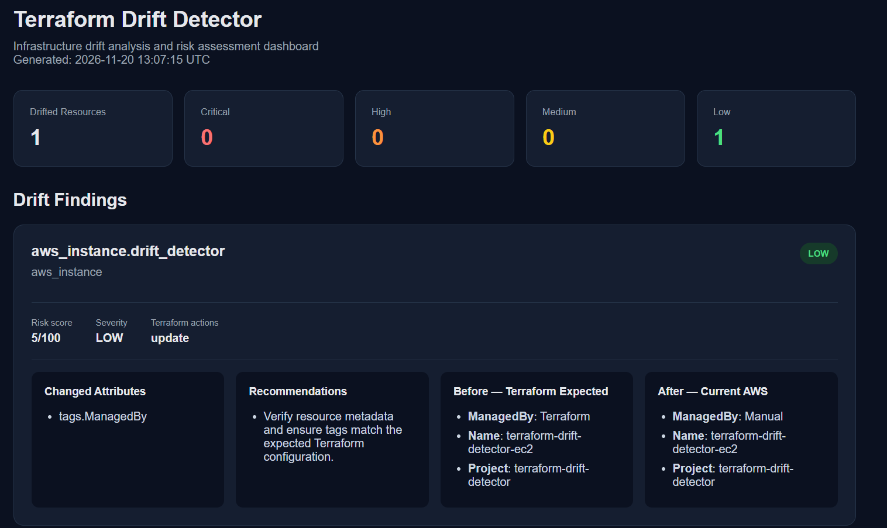

# Terraform Drift Detector

A Python-based infrastructure drift detection tool that analyzes Terraform plan JSON, identifies changes between Terraform's expected infrastructure configuration and the actual infrastructure state, and classifies detected drift based on risk.
## Dashboard Preview

The dashboard visualizes detected infrastructure drift, risk severity,
changed resource attributes, Terraform-expected values, current AWS values,
and remediation recommendations.



## Overview

Infrastructure drift occurs when cloud infrastructure is modified outside Terraform, causing the actual infrastructure to differ from the configuration managed by Terraform.

This project detects infrastructure drift, analyzes the affected resource attributes, assigns risk scores, and generates reports to help engineers identify and investigate infrastructure changes.

## Features

- Terraform drift detection from plan JSON
- Recursive analysis of nested resource attributes
- Change detection and attribute comparison
- Risk scoring and severity classification
- JSON report generation
- HTML dashboard generation
- Automated refresh-only Terraform plan workflow
- Slack notifications
- Unit tests
- GitHub Actions CI pipeline

## Architecture

Terraform infrastructure
↓
Terraform Refresh-Only Plan
↓
Plan JSON
↓
Python Drift Detection Engine
↓
Attribute-Level Diff Analysis
↓
Risk Scoring Engine
↓
JSON / HTML Reports
↓
Slack Notification

## Technology Stack

- Python
- Terraform
- AWS
- JSON
- HTML
- Slack Webhooks
- GitHub Actions
- unittest

## How Drift Detection Works

1. Terraform refreshes the infrastructure state against actual cloud resources.
2. A Terraform plan is generated to identify differences.
3. The plan is exported into JSON format.
4. The Python application analyzes the plan.
5. Resource-level drift and attribute changes are identified.
6. The risk engine assigns scores and severity levels.
7. Reports are generated for investigation.
8. Notifications can be sent through Slack.

## Risk Classification

The risk engine categorizes detected changes according to their assigned risk scores.

- LOW — Minor or low-impact infrastructure changes
- MEDIUM — Changes that may require investigation
- HIGH — Significant infrastructure changes
- CRITICAL — Potentially high-impact infrastructure changes

Risk classifications are heuristic and intended to support investigation rather than replace security reviews.

## Project Structure

Refer to the actual repository structure for the complete project layout.

## Prerequisites

- Python 3.13+
- Terraform CLI
- AWS CLI
- Configured AWS credentials for AWS-based detection
- An AWS environment containing Terraform-managed resources

## Installation

Clone the repository:

```bash
git clone https://github.com/sripadma-git/terraform-drift-detector.git
cd terraform-drift-detector
```

Initialize Terraform where applicable:

```bash
cd terraform
terraform init
terraform validate
cd ..
```

## Running the Detector

Generate a Terraform plan JSON file using the Terraform workflow configured for your environment.

Run the detector against a plan file:

```bash
python -m python.main --plan reports/automated-plan.json
```

Ensure the specified plan JSON file exists before running the command.

## Testing

Run the unit test suite:

```bash
python -m unittest discover -s tests -v
```

## Reports

The tool can generate machine-readable JSON reports and HTML reports for reviewing detected infrastructure drift and risk classifications.

## CI/CD

GitHub Actions automatically runs the test suite on repository events configured in the workflow.

The CI pipeline validates application functionality without deploying infrastructure.

## Security

- No Terraform state files are committed.
- AWS credentials are not stored in the repository.
- Sensitive generated reports are excluded where applicable.
- AWS access should follow least-privilege principles.
- The tool detects drift and does not automatically remediate infrastructure.

## Future Improvements

- Historical drift tracking
- Drift trends and metrics
- Additional cloud providers
- Configurable risk policies
- Dashboard enhancements
- Integration with incident management platforms

## Author

Sri Padma

GitHub: https://github.com/sripadma-git
